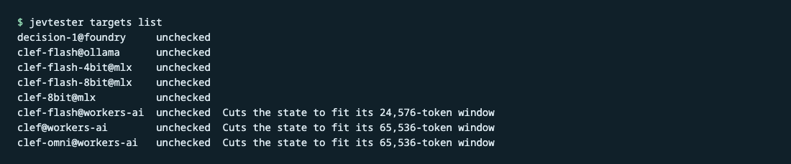
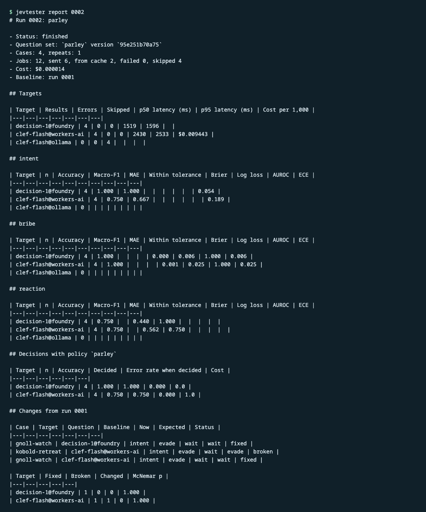
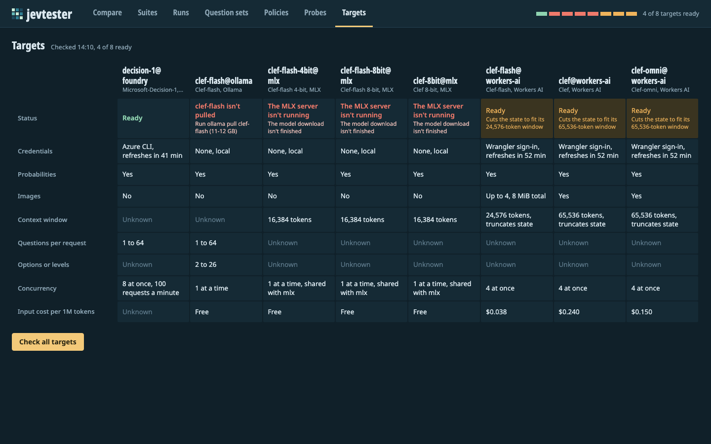
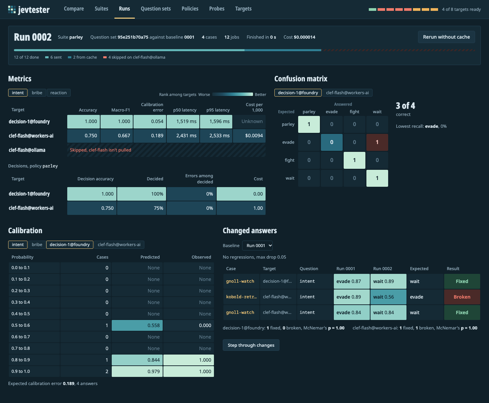

# Getting started

Install jevtester, run the included `parley` suite on one decision model, and read the report. Then open the web UI and look at the same run.

It takes about 30 minutes, plus the time to download a model if you choose a local one.

## Before you start

You need:

- macOS or Linux, with [Git](https://git-scm.com/).
- Python 3.14 and [uv](https://docs.astral.sh/uv/).
- Node 24 or later, to build the web UI.

jevtester has no built-in offline target. To run a suite, you need one real decision model. Choose one of these:

| Choice | Target | Cost | What you need |
|---|---|---|---|
| A local model | `clef-flash@ollama` | Free, and works offline once it's downloaded. | [Ollama](https://ollama.com/) 0.35.1 or later, and room for the model download. The project plan puts it at 11 to 12 GB. |
| A hosted model | `clef-flash@workers-ai` | Less than $0.0001 for this tutorial, by the estimate below. | A Cloudflare account with Workers AI. |

The hosted cost is an estimate. The config prices Clef-flash on Workers AI at $0.038 per million input tokens, with free output. One recorded parley request used 452 input tokens. If each of the four cases uses about that many, the run uses about 1,800 tokens, which costs about $0.00007. The second run in this tutorial comes from the cache and costs nothing.

## Install jevtester

1. Clone the repository and go to it:

   ```sh
   git clone https://github.com/mmacy/jevtester.git
   cd jevtester
   ```

2. Install the Python dependencies:

   ```sh
   uv sync
   ```

3. Check that jevtester runs:

   ```sh
   uv run jevtester --version
   ```

   It prints `jevtester` and its version number.

Run every `jevtester` command in this tutorial from the repository's root folder. jevtester finds its config file and the `suites/` folder there.

## Look at the suite

A *suite* is a set of test cases. Each case has a *state*, which is what the model reads, and the answers you expect. The included suite, `suites/parley.yaml`, has four cases from a tabletop role-playing game. In each one, a party of adventurers meets monsters, and the player says what they do.

Here's the first case:

```yaml
- id: goblin-bribe
  state:
    party: Three adventurers, torches lit
    monsters: Six goblins, weapons drawn, 40 feet away
    player_says: We come in peace. Take this sack of silver and let us pass to the stairs.
  expected:
    intent:
      answer: parley
    bribe:
      answer: true
    reaction:
      answer: 3
      tolerance: 1
  expected_action: parley_succeeds
```

The suite asks the questions in `suites/question-sets/parley.yaml`:

- `intent` is a *choice* question. It asks what the player is trying to do: `parley`, `evade`, `fight`, `wait`, or `cannot_tell`.
- `bribe` is a *noul* question, which is a yes/no question. It asks whether the player offers something of value.
- `reaction` is a *score* question. It places the monsters' likely reaction on five levels, from "Attack at once" (level 0) to "Friendly, accept the offer" (level 4). The case above accepts any level from 2 to 4, because its tolerance is 1.

The suite also uses a *policy*, `suites/policies/parley.yaml`. A policy turns the answers into an action, like `parley_succeeds` or `battle`. Each case's `expected_action` is the action the policy should choose.

Check that the suite is valid:

```sh
uv run jevtester suite check parley
```

It prints `Suite parley is valid`. This command calls no model. It checks that each case fits the questions, and it checks the questions' wording against the vendors' guidance.

## Set up a target

A *target* is one model on one runtime, like Clef-flash on Ollama. List the targets in the shared config:

```sh
uv run jevtester targets list
```

Each target shows as `unchecked`, because jevtester hasn't checked whether it can reach them yet.



Your own settings go in a local config file. Git ignores it, and jevtester reads it instead of `jevtester.toml` when it exists. Create it:

```sh
cp jevtester.toml jevtester.local.toml
```

Now set up one target. Follow the section for your choice.

### Choice A: Clef-flash on Ollama

1. Install Ollama 0.35.1 or later, and start it. If it isn't running as an app, start it in another terminal:

   ```sh
   ollama serve
   ```

2. Download the model. The project plan puts its size at 11 to 12 GB.

   ```sh
   ollama pull clef-flash
   ```

3. In `jevtester.local.toml`, under `[defaults]`, set the default target:

   ```toml
   targets = ["clef-flash@ollama"]
   ```

### Choice B: Clef-flash on Workers AI

1. Install Wrangler, Cloudflare's command-line tool, where `npx` can find it, and sign in. The sign-in opens a browser.

   ```sh
   npm install --global wrangler
   npx wrangler login
   ```

   jevtester runs `npx --no-install wrangler auth token --json` to get a short-lived token, so it never downloads Wrangler itself. If you have a Cloudflare API token instead, set the `CLOUDFLARE_API_TOKEN` environment variable, and jevtester uses it.

2. In `jevtester.local.toml`, under `[cloudflare]`, remove the `#` and set your Cloudflare account ID:

   ```toml
   account_id = "<your Cloudflare account ID>"
   ```

3. In `jevtester.local.toml`, under `[defaults]`, set the default target:

   ```toml
   targets = ["clef-flash@workers-ai"]
   ```

### Check the target

Run every target's health check:

```sh
uv run jevtester targets check
```

A health check calls no model, so it costs nothing. It checks that the server is running, that the model is there, and that jevtester can get a credential.

Find your target's line:

- `clef-flash@ollama` shows `ready`.
- `clef-flash@workers-ai` shows `warning` and `Wrangler sign-in`, or `CLOUDFLARE_API_TOKEN`. The warning means Workers AI cuts a long state to fit the model's context window. The parley states are short, so you can ignore it here.

Targets you didn't set up show `down`, with the reason. If your target shows `down`, its reason says what to fix, like `Ollama isn't running` or `No Cloudflare account`.

## Run the suite

Run the suite on your target. Use the target name you chose:

```sh
uv run jevtester run parley --target clef-flash@ollama
```

jevtester checks the target, sends one request per case, and saves the results. While it works, it prints a line for each case:

```text
Run 0001 started
1/4  goblin-bribe  clef-flash@ollama  ok
2/4  orc-charge  clef-flash@ollama  ok
3/4  kobold-retreat  clef-flash@ollama  ok
4/4  gnoll-watch  clef-flash@ollama  ok
```

The cases can finish in another order. When the run ends, jevtester prints its summary:

```text
Run 0001 finished: 4 jobs, 4 sent, 0 from cache, 0 failed, 0 skipped, cost unknown
  clef-flash@ollama  4 sent, 0 cached, 0 failed
```

The run's id is `0001`. jevtester numbers runs in order, starting at `0001`. On Ollama the cost is unknown, because the target has no price in the config. On Workers AI, the summary shows the cost in US dollars.

Run the same command again. This time every result comes from the cache, so the run costs nothing:

```text
Run 0002 finished: 4 jobs, 0 sent, 4 from cache, 0 failed, 0 skipped, $0.000000
  clef-flash@ollama  0 sent, 4 cached, 0 failed
```

jevtester caches each result by the target and the exact request. A rerun sends only the requests that changed. To send every request again, add `--no-cache`.

## Read the report

Print the first run's report:

```sh
uv run jevtester report 0001
```

The report is Markdown. It has these sections:

- **The summary**: the run's status, the question set and its version, the number of cases, and the cost.
- **Targets**: for each target, the number of results and errors, the median (p50) and 95th percentile (p95) latency, and the cost of 1,000 requests.
- **One table per question**: the metrics for that question. Which columns have values depends on the question type.
- **Decisions with policy `parley`**: how often the policy chose the expected action.



Here's the `intent` table from a sample run in the test fixtures. Your numbers will differ.

```text
## intent

| Target | n | Accuracy | Macro-F1 | MAE | Within tolerance | Brier | Log loss | AUROC | ECE |
|---|---|---|---|---|---|---|---|---|---|
| decision-1@foundry | 4 | 1.000 | 1.000 |  |  |  |  |  | 0.054 |
| clef-flash@workers-ai | 4 | 0.750 | 0.667 |  |  |  |  |  | 0.189 |
```

Read your report's tables this way:

- `n` is the number of cases with an expected answer for the question. The parley suite has four.
- *Accuracy* is the share of answers that matched. For `reaction`, it's the share that hit the expected level exactly, and *Within tolerance* is the share within one level.
- *Macro-F1* applies to the `intent` choice. It's the F1 score of each option, averaged so every option counts equally.
- *MAE* is the `reaction` score's average distance from the expected level.
- *Brier*, *Log loss*, and *AUROC* apply to the `bribe` yes/no question. Lower Brier and log loss are better. An AUROC of 1 is perfect.
- *ECE*, the expected calibration error, measures whether the model's probabilities match how often it's right. Lower is better.

In the decisions table, *Decided* is the share of cases the policy decided without escalating to a person. *Error rate when decided* is the share of those decisions that were wrong.

Four cases are too few to judge a model. They show what jevtester measures. [Concepts](concepts.md#metrics) explains each metric.

To get the same report as JSON, add `--format json`. Every command except `serve` takes `--format json`.

## Open the web UI

The web UI shows the same runs, and lets you ask questions and edit suites in the browser.

1. Build the web UI:

   ```sh
   cd web
   npm install
   npm run build
   cd ..
   ```

   The build writes the UI to `src/jevtester/static/`. Git ignores that folder.

2. Start the server:

   ```sh
   uv run jevtester serve
   ```

   It serves the HTTP API and the web UI at <http://127.0.0.1:8640>. It listens on your own computer only.

3. Open <http://127.0.0.1:8640> in a browser. The UI opens on the **Compare** view.

4. Select **Targets**, then **Check all targets**. Your target shows as ready, or as warning on Workers AI. The server starts with no health checks, so every target shows as unchecked until you check.

   

5. Select **Runs**, then select run `0001`. The run's page shows the metrics for each target and question, with panels for the confusion matrix, calibration, and changed answers.

   

6. Select **Compare**. Type a state, like `Six goblins block the stairs.`, and a question, like `Are the goblins hostile?`. Select **Ask**. A question with no options is a yes/no question, so the answer is the probability of yes. The UI shows it with the latency and token counts.

To stop the server, press Ctrl+C in its terminal.

## Next steps

- [Concepts](concepts.md) explains decision models, metrics, and policies.
- [How-to guides](how-to.md) show how to set up the other targets, write your own suite, and compare runs.
- The [CLI reference](reference/cli.md) lists every command and flag.
