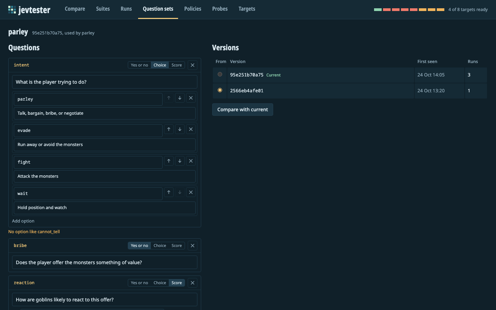
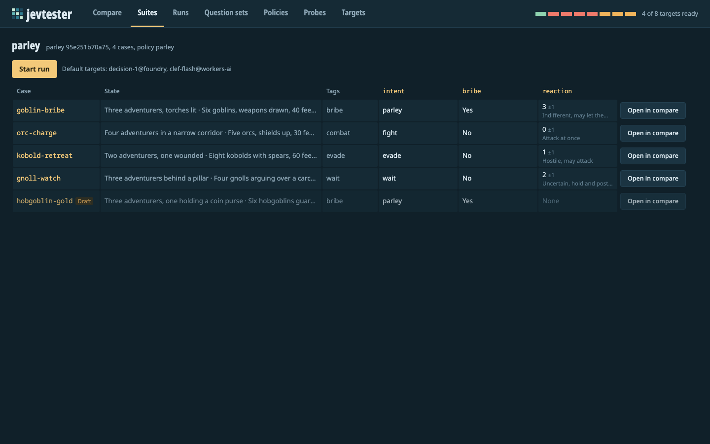
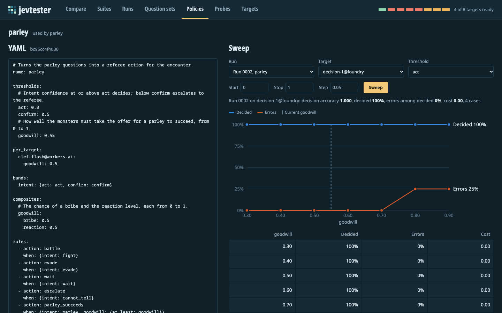
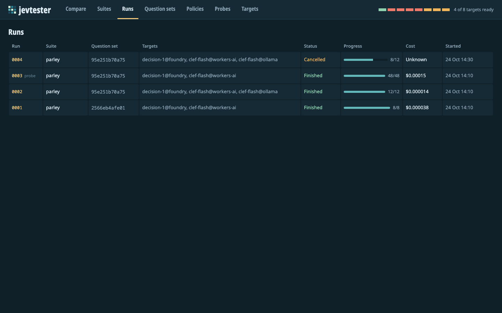
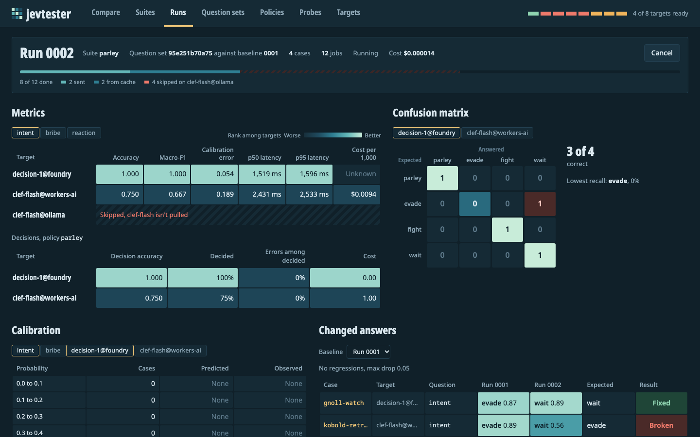
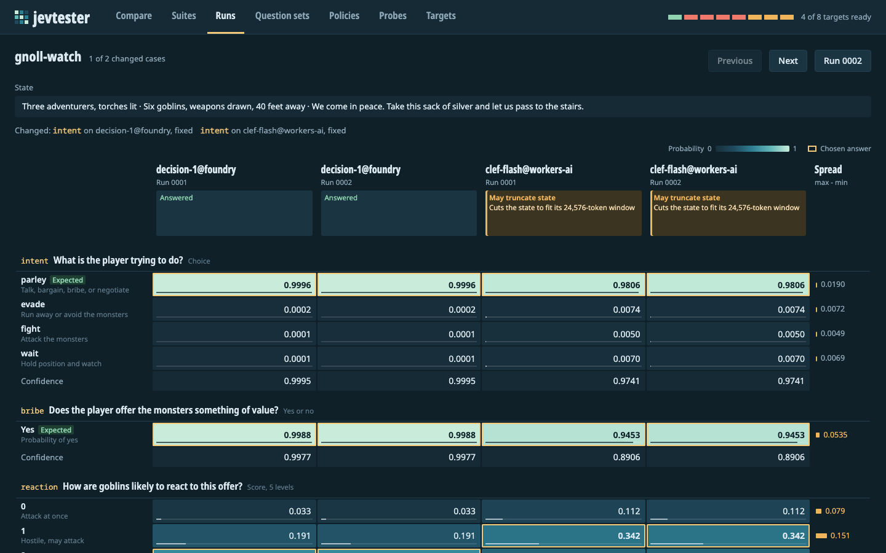
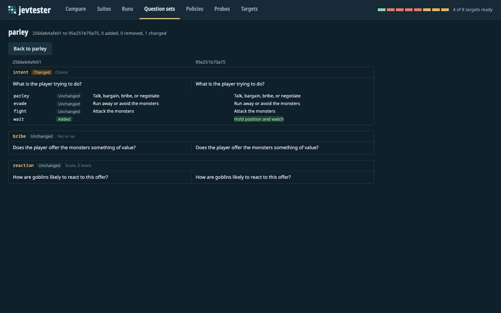
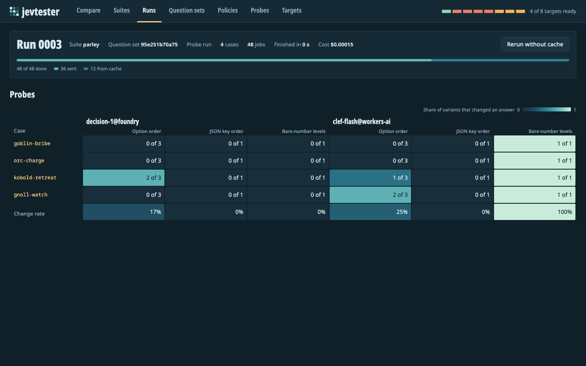

# How-to guides

Install jevtester first, as [Getting started](getting-started.md) shows. Run every command from the repository's root folder.

## Set up a target

A target is one model on one runtime. `jevtester.toml` lists every target jevtester supports. Before you set one up, create your local config, as [Keep your account details in a local config](#keep-your-account-details-in-a-local-config) shows.

After you set up a target, check it:

```sh
uv run jevtester targets check
```

Each target's line shows `ready`, `warning`, or `down`. A target with `warning` can take requests, and its line shows the warning. A target with `down` gives the reason. A health check calls no model, so it costs nothing.

### Microsoft-Decision-1 on Azure AI Foundry

The `decision-1@foundry` target calls a deployment of Microsoft-Decision-1 on your own Foundry resource. jevtester signs in with the Azure CLI (`az`) through Microsoft Entra ID. It doesn't use Foundry API keys.

1. Deploy Microsoft-Decision-1 on a Foundry resource, as [Microsoft's guide](https://learn.microsoft.com/en-us/azure/foundry/foundry-models/how-to/use-foundry-models-microsoft-decision) shows. For example, with the Azure CLI:

   ```sh
   az cognitiveservices account deployment create \
     --name <your Foundry resource> \
     --resource-group <your resource group> \
     --deployment-name decision-1 \
     --model-name "Microsoft-Decision-1" \
     --model-format Microsoft \
     --model-version "1" \
     --sku-name GlobalStandard \
     --sku-capacity 1
   ```

2. Sign in with the Azure CLI:

   ```sh
   az login
   ```

   jevtester asks the sign-in for a token, keeps it in memory, and gets a new one five minutes before it expires.

3. In `jevtester.local.toml`, in the `[targets."decision-1@foundry"]` table:

   - In `base_url`, replace `example-resource` with your Foundry resource's name.
   - Set `model` to your deployment's name. The shared config uses `decision-1`.

4. If your deployment's rate limits differ from the config's, change `requests_per_minute` and `tokens_per_minute` under `[targets."decision-1@foundry".capabilities]`. jevtester spaces its requests to stay under both.

`targets check` shows the target as `ready`, with `Azure CLI, refreshes in` and a number of minutes. The health check only gets a token. It doesn't contact your resource, so it can't catch a wrong resource or deployment name. To check those, ask one question, which costs one request:

```sh
uv run jevtester decide --target decision-1@foundry --state "Six goblins block the stairs." --question "Are the goblins hostile?"
```

The config has no price for this target, so jevtester reports its cost as unknown. Foundry bills you for the deployment.

### Clef on Cloudflare Workers AI

Three targets call Clef models on Workers AI in your Cloudflare account: `clef-flash@workers-ai`, `clef@workers-ai`, and `clef-omni@workers-ai`. jevtester gets a token from the Wrangler sign-in, or from the `CLOUDFLARE_API_TOKEN` environment variable.

1. Choose how jevtester gets a token:

   - **Wrangler sign-in.** Install Wrangler where `npx` can find it, and sign in:

     ```sh
     npm install --global wrangler
     npx wrangler login
     ```

     jevtester runs `npx --no-install wrangler auth token --json` to read a short-lived token. `--no-install` keeps `npx` from downloading Wrangler. jevtester reads the token again every 10 minutes, and after a request is refused with HTTP 401.

   - **API token.** Set `CLOUDFLARE_API_TOKEN` in the environment where you run jevtester. When it's set, jevtester uses it instead of Wrangler.

2. In `jevtester.local.toml`, under `[cloudflare]`, remove the `#` and set your account ID:

   ```toml
   [cloudflare]
   account_id = "<your Cloudflare account ID>"
   ```

`targets check` searches your account's Workers AI catalog for each model. A ready Workers AI target shows `warning`, because Workers AI cuts a long state to fit the model's context window without an error. jevtester also warns on any result whose request may be cut.

The config contains each model's price per million input tokens, so jevtester reports the cost of each request and run. Output tokens are free.

| Target | Context window | Input price per million tokens |
|---|---|---|
| `clef-flash@workers-ai` | 24,576 tokens | $0.038 |
| `clef@workers-ai` | 65,536 tokens | $0.24 |
| `clef-omni@workers-ai` | 65,536 tokens | $0.15 |

### Clef-flash on Ollama

The `clef-flash@ollama` target calls Clef-flash on a local Ollama server at `http://localhost:11434`. It's free, and it works offline once the model is downloaded.

1. Install [Ollama](https://ollama.com/) 0.35.1 or later. Earlier versions can't serve Clef-flash.

2. Start Ollama, if it isn't already running:

   ```sh
   ollama serve
   ```

3. Download the model. The project plan puts its size at 11 to 12 GB.

   ```sh
   ollama pull clef-flash
   ```

`targets check` shows `ready` when Ollama is running, is recent enough, and has the model. Otherwise, it says which of the three to fix.

Ollama handles one request at a time in this config, so a suite runs one case at a time.

### Clef on a local MLX server

On a Mac with Apple silicon, three targets call Clef through MLX, Apple's machine learning framework: `clef-flash-4bit@mlx`, `clef-flash-8bit@mlx`, and `clef-8bit@mlx`. A server script in the model repository on Hugging Face, `clef_mlx.py`, serves the System One API at `http://127.0.0.1:8000`.

These steps come from the [project plan](plan.md). They haven't been tested end to end with jevtester. The plan confirms `clef_mlx.py` in `clef-8bit` and `clef-flash-4bit`, but not in `clef-flash-8bit`.

1. Download one of these model repositories from Hugging Face. The downloads are large. The plan says Clef (`clef-8bit`) needs about 31 to 33 GB of memory at its peak.

   - `mlx-community/clef-flash-4bit`
   - `mlx-community/clef-flash-8bit`
   - `mlx-community/clef-8bit`

2. Install the server's dependencies:

   ```sh
   pip install "mlx-vlm>=0.7.4,<0.8" huggingface_hub
   ```

3. Delete the `__pycache__` folder from the download, so Python runs the `clef_mlx.py` source and not a compiled copy. The plan's review covered the source, not the compiled copy.

4. In the download's folder, start the server:

   ```sh
   python clef_mlx.py serve --no-truncate
   ```

   Without `--no-truncate`, the server cuts long input to 16,384 tokens without telling you. jevtester also sends `"truncate": false` in each request, so a request that's too long fails with HTTP 413 instead.

The server serves one model. `targets check` asks the server's `/health` route which model it has loaded. The target for that model shows `ready`, and the other MLX targets show `down` with the name of the loaded model. The three MLX targets share one limit of one request at a time.

## Keep your account details in a local config

`jevtester.toml` is the shared config. It's in git, so it contains placeholders, not your account details. Put your details in `jevtester.local.toml`, which git ignores.

1. Copy the shared config:

   ```sh
   cp jevtester.toml jevtester.local.toml
   ```

2. Edit `jevtester.local.toml`. Set your account details, as [Set up a target](#set-up-a-target) shows.

3. Set the targets that commands use when you don't name any:

   ```toml
   [defaults]
   targets = ["clef-flash@workers-ai"]
   ```

   Each name must be a target in the same file, or jevtester refuses to load the config.

jevtester picks its config file in this order:

1. The file named by `--config`, like `uv run jevtester --config other.toml targets list`.
2. The file named by the `JEVTESTER_CONFIG` environment variable.
3. `jevtester.local.toml` in the current folder, if it exists.
4. `jevtester.toml` in the current folder.

jevtester reads only one of these files. It doesn't merge them. So when you add a target to `jevtester.toml`, copy it to your local file too.

The suites folder and the run database are relative to the config file's folder. By default, they're `suites/` and `.jevtester/runs.sqlite`. To change them, set `suites` and `store` under `[paths]`. The [configuration reference](reference/config.md) lists every setting.

The tests read `jevtester.toml`, never your local file, so they don't depend on your account. Only the [live tests](#run-the-live-tests) read your local file.

## Ask a quick question

`jevtester decide` sends one state and its questions to one or more targets, and prints the answers. It's the fastest way to try a question before you add it to a suite.

A question with no options is a yes/no question:

```sh
uv run jevtester decide --state "Six goblins block the stairs." --question "Are the goblins hostile?"
```

Add `--option` for each option to make a choice question. Each option is `NAME=DESCRIPTION`:

```sh
uv run jevtester decide --state "We come in peace. Take this silver." \
  --question "What is the player trying to do?" \
  --option parley="Talk, bargain, bribe, or negotiate" \
  --option fight="Attack the monsters" \
  --option cannot_tell="The player's words don't show what they're trying to do"
```

Add `--level` for each level, lowest first, to make a score question:

```sh
uv run jevtester decide --state "The goblins lower their spears." \
  --question "How are the monsters likely to react?" \
  --level "Attack at once" --level "Uncertain, hold and posture" --level "Friendly, accept the offer"
```

Other ways to give the input:

- `--state @encounter.json` reads the state from a file. If the file is JSON, jevtester sends it as JSON.
- `--state -` reads the state from standard input.
- `--request request.json` reads a whole request, with `state` and `questions`, from a file.

To send the request to several targets at once, repeat `--target`, or use `--targets all`. Add `--format json` to get the full result, including the exact request and response bodies.

## Write a question set

A question set is a YAML file in `suites/question-sets/`. Its file name, without `.yaml`, must match its `name`. A name uses lowercase letters, digits, `-`, and `_`.

```yaml
name: door
questions:
  locked:
    type: noul
    instructions: Is the door locked?
  approach:
    type: choice
    instructions: How is the player trying to get through the door?
    criteria:
      force: Break, kick, or bash the door
      pick: Pick or open the lock with a tool
      talk: Ask someone on the other side to open it
      cannot_tell: The player's words don't show how they're trying to get through
  noise:
    type: score
    instructions: How much noise does the player's action make?
    criteria:
      - Silent, no one nearby would notice
      - A soft sound, heard only in the same room
      - A loud sound, heard down the corridor
      - A crash heard throughout the level
```

Each key under `questions` is the question's id. The model doesn't see it, so put everything it needs in `instructions` and the criteria. [Concepts](concepts.md#questions) explains the question types and the wording guidance.

jevtester identifies each version of a question set by a hash of its questions. When you edit the file, the next run asks the new version and records it.

You can also edit a question set in the web UI. In **Question sets**, open the set, change it, and select **Save version**. The UI writes the YAML file.



## Write a suite

A suite is a YAML file in `suites/`. Its file name, without `.yaml`, must match its `name`.

```yaml
name: door
question_set: door
targets:
- clef-flash@ollama
cases:
- id: kick-door
  state: The player kicks the oak door as hard as they can.
  expected:
    approach:
      answer: force
    noise:
      answer: 3
      tolerance: 1
  expected_action: break_in
  tags:
  - force
```

- `question_set` is the name of the question set the cases are asked.
- `policy` is optional, and this suite has none. It's the name of a policy in `suites/policies/`, as [Write a policy](#write-a-policy) shows.
- `targets` lists the targets a run uses when you don't name any. If it's empty, a run uses the config's default targets.
- Each case has an `id` and a `state`. The state can be text, a JSON object, or a JSON array.
- `expected` maps question ids to the expected answer: `true` or `false` for a noul, an option name for a choice, or a level number for a score. A case can leave a question out.
- `acceptable` lists other answers that count as correct. `tolerance` gives a score that many levels of slack.
- `expected_action` is the action the policy should choose.



The [suite format reference](reference/suite-format.md) lists every field.

### Add cases from the command line

`jevtester case add` adds a case to the end of a suite:

```sh
uv run jevtester case add door --id pick-lock \
  --state "The player slides a thin pick into the keyhole." \
  --expect approach=pick --expect noise=0 --tolerance noise=1 \
  --expected-action pick_lock --tag pick
```

You can also turn a `decide` call into a case. Save the decide output as JSON, then add it with `--from-decide`. The case gets the decide call's state. `--expect-from` copies one target's answers as the expected answers, so check them before you rely on them. Give the decide question the same id as the suite's question, with `--id`, so the expected answer goes to the right question:

```sh
uv run jevtester decide --target clef-flash@ollama --format json \
  --state "The player knocks and asks the guard to open up." \
  --id approach --question "How is the player trying to get through the door?" \
  --option force="Break, kick, or bash the door" --option pick="Pick or open the lock with a tool" \
  --option talk="Ask someone on the other side to open it" \
  --option cannot_tell="The player's words don't show how they're trying to get through" > knock.json
uv run jevtester case add door --id knock --from-decide knock.json --expect-from clef-flash@ollama
```

`case add` rewrites the suite file, so it drops any comments in it. In the web UI, **Save as case** in the **Compare** view does the same thing.

### Check the suite

```sh
uv run jevtester suite check door
```

It reports each case whose expectations don't fit the questions, like an option the question doesn't have or a level out of range. It checks that the policy uses only questions the set asks. Then it lists the wording findings that [Concepts](concepts.md#wording-guidance) describes. It exits with code 2 when the suite is invalid.

## Write a policy

A policy is a YAML file in `suites/policies/`. It turns a result's answers into an action. This one is `suites/policies/parley.yaml`, which comes with jevtester, without its comments:

```yaml
name: parley

thresholds:
  act: 0.8
  confirm: 0.5
  goodwill: 0.55

per_target:
  clef-flash@workers-ai:
    goodwill: 0.5

bands:
  intent: {act: act, confirm: confirm}

composites:
  goodwill:
    bribe: 0.5
    reaction: 0.5

rules:
  - action: battle
    when: {intent: fight}
  - action: evade
    when: {intent: evade}
  - action: wait
    when: {intent: wait}
  - action: escalate
    when: {intent: cannot_tell}
  - action: parley_succeeds
    when: {intent: parley, goodwill: {at_least: goodwill}}
  - action: parley_fails
    when: {intent: parley}

costs:
  parley_succeeds:
    battle: 5
    parley_fails: 2
  battle:
    parley_succeeds: 5
```

It works like this:

1. `thresholds` names three numbers. `per_target` gives Clef-flash on Workers AI a different `goodwill` value, because probabilities differ between models.
2. The `intent` band escalates when the intent's confidence is below `confirm` (0.5). Between 0.5 and `act` (0.8), the policy acts and marks the decision for confirmation.
3. The `goodwill` composite adds half the probability of a bribe and half the reaction score divided by its top level (4), so it runs from 0 to 1.
4. The rules are checked in order. A parley succeeds only when `goodwill` is at least the `goodwill` threshold. Otherwise the next rule makes it fail.
5. `costs` makes a wrong `parley_succeeds` or `battle` cost 5. Any other wrong action costs 1.

When no rule matches, the action is `default`, which is `escalate` unless you set it. [Concepts](concepts.md#policies) explains each part, and the [suite format reference](reference/suite-format.md) lists every field.

jevtester validates a policy when it loads it. Bands and ranges can name only thresholds the policy defines. A composite can't share a name with a question that a band or a composite reads.

To use the policy, name it in a suite's `policy` field, and give the suite's cases an `expected_action`. Each run's report then has a decisions table.

You can also edit a policy in the web UI, in **Policies**. The UI checks the YAML before it saves it, and keeps your comments.

### Tune a threshold

A sweep replays a finished run with one threshold set to each value in a range. It calls no model.

```sh
uv run jevtester policy sweep parley --run 0001 --target clef-flash@ollama --threshold act --start 0.5 --stop 1 --step 0.05
```

For each value, it prints the share of cases decided without escalating, the error rate among those, and the cost. Choose the value with the trade-off you want, then set it in the policy. The sweep uses the policy file as it is now, so you can edit the policy and sweep again.

The **Policies** view in the web UI draws the same sweep as a chart.



## Run a suite on several targets

Name each target with `--target`:

```sh
uv run jevtester run parley --target clef-flash@ollama --target clef-flash@workers-ai
```

Without `--target`, a run uses the suite's `targets`, or else the config's default targets.

Before the run sends anything, jevtester checks each target. It skips a target that's down and prints the reason. The other targets still run. When no request succeeds or comes from the cache, the command exits with code 3.

jevtester sends requests to different targets at the same time. Each target's `concurrency` capability limits how many of its requests are in flight at once.

In the web UI, the **Runs** view lists every run, and a run's page shows its progress while it runs.





To measure whether a target gives the same answer every time, send each request several times:

```sh
uv run jevtester run parley --target clef-flash@ollama --repeats 3
```

The run's metrics then include *consistency*: the share of repeated cases with the same answer in every repeat. The web UI's **Metrics** panel and `jevtester report --format json` show it. The Markdown report doesn't. Each repeat is cached separately.

## Compare two runs

Compare a run with an earlier one, the *baseline*:

```sh
uv run jevtester compare 0003 0001
```

It lists each answer that changed between the runs, for the targets both runs ran, and labels it `fixed`, `broken`, or `changed`. For each target, it prints the counts and McNemar's test. Then it lists any *regression*: a target and question whose accuracy dropped by more than the allowed amount.

The allowed drop is `defaults.max_drop` in the config, 0.05 unless you set it. To change it for one comparison, add `--max-drop`:

```sh
uv run jevtester compare 0003 0001 --max-drop 0.1
```

`compare` exits with code 1 when it finds a regression, so a script or a continuous integration job can fail on it.

To record the baseline with the run, add `--baseline` when you start it. The run's report then has a section with the changes:

```sh
uv run jevtester run parley --target clef-flash@ollama --baseline 0001
```

In the web UI, a run's page in **Runs** has a **Changed answers** panel. Pick a baseline there, and step through each changed case.



## Compare two question set versions

To see whether a wording change helps, run the old and new versions of a question set on the same cases, then compare the runs.

1. Run the suite with the current question set:

   ```sh
   uv run jevtester run parley --target clef-flash@ollama
   ```

2. Edit `suites/question-sets/parley.yaml`, and run the suite again with the first run as the baseline:

   ```sh
   uv run jevtester run parley --target clef-flash@ollama --baseline 0001
   ```

3. Compare the runs:

   ```sh
   uv run jevtester compare 0002 0001
   ```

To run an older version again, pass its hash, or the first 8 or more characters of it, with `--question-set-version`. Each run's report shows the first 12 characters of the version it asked.

To see what changed between two versions, open the question set in the web UI's **Question sets** view. Its version list shows every version jevtester has seen and how many runs used each. Select an older version, then **Compare with current**. The diff shows each question and each option as added, removed, changed, or unchanged. The same diff is in the HTTP API:



```sh
curl "http://127.0.0.1:8640/api/question-sets/parley/diff?from=<older version>&to=<newer version>"
```

jevtester records a version when it reads the question set for a run, or when the server lists or opens it. A version you edited and never ran or opened isn't in the list.

## Probe a suite

A probe changes each case in a way that shouldn't change the answers, and measures how often they change anyway.

```sh
uv run jevtester probe parley --target clef-flash@ollama
```

By default, it runs three probes: `option_order`, `key_order`, and `bare_levels`. For each target and probe, it prints the change rate, then each case whose answers changed. To choose the probes, repeat `--variant`. `pad_state` fills most of the target's context window, so it sends large requests and costs more on a hosted target:

```sh
uv run jevtester probe parley --target clef-flash@ollama --variant pad_state
```

A probe run is a run, so it has an id and appears in the web UI's **Runs** and **Probes** views. [Concepts](concepts.md#probes) explains each probe.



## Use the HTTP API from another app

`jevtester serve` serves an HTTP API with the same operations as the CLI. Another app can use it to ask decision models questions, without holding any credentials itself. jevtester keeps the tokens on the server.

[ironsworn-tui](https://github.com/mmacy/ironsworn-tui), a terminal game, works this way. It starts `jevtester serve` when the game starts, sends each turn's questions to `POST /api/decide`, and saves the move the player picks as a test case with `POST /api/suites/{name}/cases`.

1. Start the server from your app, on a free port, with your app's config:

   ```sh
   uv run --project <path to jevtester> jevtester --config <path to your jevtester.toml> serve --port 8650
   ```

   jevtester reads suites from the `suites/` folder beside that config, and keeps runs in `.jevtester/` beside it. The server listens on `127.0.0.1` only.

2. Wait until `GET /api/targets` answers. That shows the server is ready.

3. Optional: check the targets with `POST /api/targets/check`. A request to a target whose last check failed returns an error without being sent. A target that hasn't been checked is sent the request.

4. Send a request to `POST /api/decide`:

   ```sh
   curl -X POST http://127.0.0.1:8650/api/decide \
     -H "Content-Type: application/json" \
     -d '{
       "state": "Six goblins block the stairs.",
       "questions": {
         "hostile": {"type": "noul", "instructions": "Are the goblins hostile?"}
       },
       "targets": ["clef-flash@ollama"],
       "timeout_s": 30
     }'
   ```

   `targets` is optional. Without it, jevtester uses the config's default targets. `timeout_s` is optional too.

5. Read the answers. The response has one result per target, in the order you named them:

   ```json
   {
     "results": [
       {
         "target": "clef-flash@ollama",
         "ok": true,
         "answers": {
           "hostile": {"type": "noul", "probability": 0.93, "confidence": 0.86, "server_confidence": null}
         },
         "error": null,
         "warnings": []
       }
     ]
   }
   ```

   This example leaves out some fields. When a target fails, its result has `"ok": false` and an `error` with a `code` and a `message`. The HTTP status is still 200, and the other targets' results still arrive. An invalid request gets HTTP 422.

6. To save a request as a test case, send it to `POST /api/suites/{name}/cases`, with the case as the body. The response is HTTP 201. If the suite already has a case with that id, the response is HTTP 409.

The server also has interactive API docs at `/docs`, like <http://127.0.0.1:8640/docs> on the default port. The [HTTP API reference](reference/http-api.md) lists every route, and `docs/openapi.json` is the full schema.

The API allows browser requests only from the web UI's development server. Call it from your app's backend, not from a web page on another origin.

## Run the live tests

The test suite calls no model. A few tests call real targets instead, and pytest skips them unless you ask for them. They read your `jevtester.local.toml`, and they cost a few requests.

| Test file | Live tests | Needs |
|---|---|---|
| `tests/test_decide.py` | A decide request and a health check on `decision-1@foundry` | Foundry set up, and `decision-1@foundry` as the first default target |
| `tests/test_workers_ai.py` | A decide request on `clef-flash@workers-ai`, and a health check on all three Workers AI targets | Workers AI set up |

Run all of them:

```sh
uv run pytest -m live
```

Run the ones for one target:

```sh
uv run pytest -m live tests/test_workers_ai.py
```

## Build the web UI

`jevtester serve` serves the web UI from `src/jevtester/static/`. Git ignores that folder, so you build it once after you clone, and again after the UI changes. You need Node 24 or later.

```sh
cd web
npm install
npm run build
```

Without the build, `jevtester serve` serves the API, and <http://127.0.0.1:8640> shows a page with these commands. Reload the page after the build.

To work on the UI, run its development server at <http://127.0.0.1:5173>. It reloads as you edit:

```sh
npm run dev
```

It sends API requests to `jevtester serve` on port 8640, so start that too. To work without a backend, answer API requests from the saved responses in `tests/fixtures/api/` instead:

```sh
npm run dev:fixtures
```

`web/README.md` lists the UI's checks.
